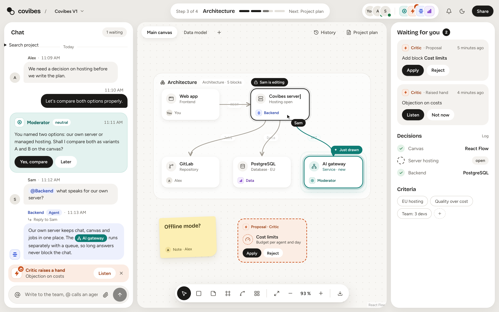
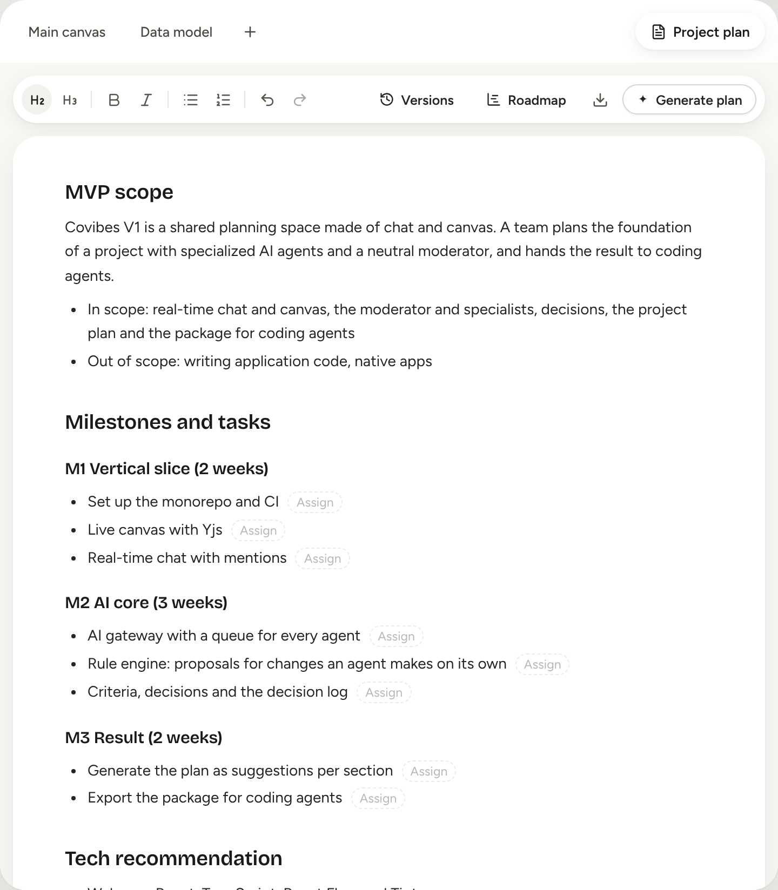
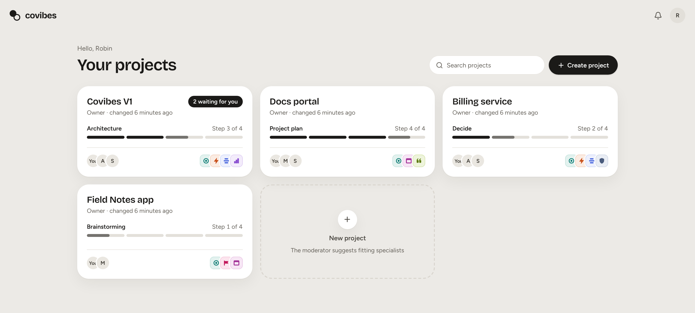
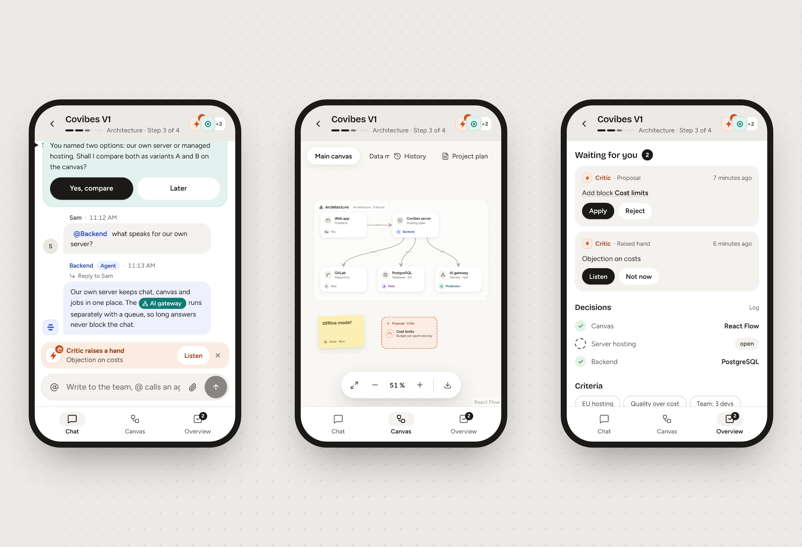
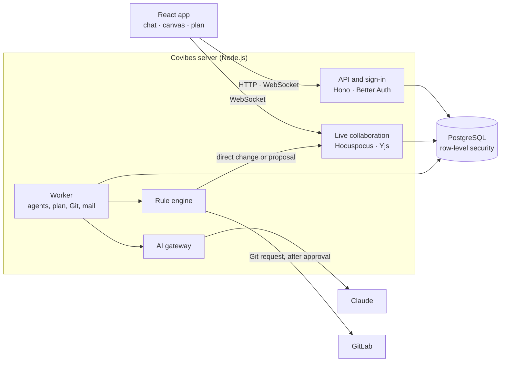

<div align="center">

<picture>
  <source media="(prefers-color-scheme: dark)" srcset="docs/media/logo-dark.svg">
  
</picture>

# Covibes

**The planning space in front of your coding agents.**<br>
Chat and canvas for your team, specialized AI agents and a neutral moderator: from the first idea to a plan that coding agents can build from.

[](https://github.com/JulianRudrich/covibes/actions/workflows/ci.yml)
[](https://github.com/JulianRudrich/covibes/actions/workflows/lint.yml)


<picture>
  <source media="(prefers-color-scheme: dark)" srcset="docs/media/workspace-dark.png">
  
</picture>

</div>

> [!NOTE]
> Covibes is in active development and has not been released. The repository is private. A closed beta by invitation follows the current rework (milestone M8) and the launch preparation; [Status and roadmap](#status-and-roadmap) has the details.

## Contents

[Why Covibes](#why-covibes) · [Features](#features) · [How it works](#how-it-works) · [Getting started](#getting-started) · [Commands](#commands) · [Self-hosting](#self-hosting) · [Project structure](#project-structure) · [Documentation](#documentation) · [Status and roadmap](#status-and-roadmap) · [Contributing](#contributing) · [License](#license)

## Why Covibes

Coding agents build quickly, but what they build is decided before the first line of code: the scope, the architecture, the trade-offs and the plan. Covibes is the place where a team makes those decisions together with AI agents. Specialists bring different perspectives and also disagree, a neutral moderator keeps the discussion on track and records what was decided, and the result goes straight into the repository and to coding agents such as Claude Code or Cursor.

**Covibes steers, coding agents build.** Covibes agents write no application code.

## Features

- **One shared space, live.** Every project is a chat and an infinite canvas. Everyone sees messages, blocks, cursors and edits as they happen, with presence and a lock while someone edits.
- **A neutral moderator.** Call it with `@Moderator` at any time. It turns ideas into diagrams, compares options against your criteria, offers compromises, notices consensus and offers help, but never starts on its own. Its stance and the way your team decides are settings of the project.
- **Specialists that disagree.** A catalog of nine roles, from critic and backend to security and data, plus agents of your own with their own instructions and knowledge. Agents raise a hand before they speak up, and visible debates between agents end with a summary.
- **Agents propose, people decide.** A rule engine checks every change an agent makes: an instruction is carried out, anything an agent does on its own initiative becomes a proposal, and alternatives appear as variants A and B side by side.
- **Decisions you can trace.** Criteria, decisions with their reasoning and the discarded alternatives, votes, and a decision log. Decisions link to the blocks and tasks they justify, so you can ask what changes if one falls; a reopened decision starts a new round.
- **Diagrams, not doodles.** Typed frames for mind maps, architectures, data models, flows and sitemaps, with auto-layout, several boards per project, references from the chat to the canvas, and a history from which changes can be taken back.
- **A plan that keeps up.** The moderator writes the project plan as suggestions per section, notices when decisions make it outdated, and keeps every version. Milestones appear as a roadmap on the canvas, and tasks are assigned to people.
- **Straight to coding agents.** Export boards as PNG, SVG and Mermaid and the plan as Markdown and PDF, or download one package with `CLAUDE.md`, `AGENTS.md`, the context files and a feature spec for every task, which the moderator writes out on request.
- **Connected to your repository.** Agents read the repository; issues, the plan package as a merge request, merging and review comments are requests that wait for approval. Covibes follows the status of tasks and reviews merge requests against the architecture. GitLab is supported today; GitHub follows.
- **Built for teams.** Invitations, roles, a read-only link, mentions, notifications in the app and by email, and "Since you were away" for everyone who returns.
- **Sign-in without passwords.** Email codes and links, passkeys, and GitHub, Google or GitLab when configured, with an optional second factor. People manage their sessions, export their data and delete their account, and the closed beta admits only invited or allowlisted addresses.
- **Costs under control.** Budgets per project, person and instance are reserved before every model call, every attempt is accounted for, and owners see the usage per agent, person and day.
- **Work that survives restarts.** Interrupted agent turns resume without repeating their changes, mail and repository jobs keep running when AI is unavailable, and documents only count as saved once the database has them.
- **Made for long projects.** Older messages load as you scroll, every message and element can be found by search, and large boards stay quick to navigate.
- **Covibes Studio design.** A calm, rounded interface in light and dark, layouts for phones and tablets, and German or English for the interface and for each project.
- **Yours to run.** Local development needs nothing but Node.js and pnpm, and a private instance runs with Docker.

| Project plan | Your projects |
|:-:|:-:|
| <picture><source media="(prefers-color-scheme: dark)" srcset="docs/media/plan-dark.png"></picture> | <picture><source media="(prefers-color-scheme: dark)" srcset="docs/media/projects-dark.png"></picture> |
| The moderator writes it, the team decides what goes in. | Every project shows its phase, team and what waits for you. |

<p align="center">
  <picture>
    <source media="(prefers-color-scheme: dark)" srcset="docs/media/mobile-dark.png">
    
  </picture>
  <br><sub>Chat, canvas and overview on a phone. More images and thumbnails are in <a href="docs/media/README.md">docs/media</a>.</sub>
</p>

## How it works



- **The browser** only shows the interface. It talks to the Covibes server alone and holds no secrets.
- **The Covibes server** is the only way to the data. It signs people in, answers the API, keeps boards and the plan in sync with Yjs, and runs long work as jobs in a worker: agent turns, the plan, Git actions and mail.
- **PostgreSQL** holds everything and checks permissions a second time with row-level security, for the person each request acts for.
- **Agents** reach models only through the AI gateway, and every change they make passes the rule engine. Git actions always wait for a person's approval.

| Area | Technology |
|---|---|
| Interface | React 19, TypeScript, Vite, TanStack Router and Query, Tailwind CSS 4 |
| Canvas and plan | React Flow, ELK, Tiptap, Yjs with Hocuspocus |
| Server | Node.js, Hono, Better Auth, Graphile Worker |
| Database | PostgreSQL 18 with row-level security, Kysely, SQL migrations |
| AI | Claude through the Claude Agent SDK, behind Covibes' own AI gateway |
| Quality | Vitest, ESLint, Prettier, GitHub Actions |

[`context/architecture.md`](context/architecture.md) describes the system boundaries, core flows and invariants in depth.

## Getting started

You need **Node.js 24** (see [`.nvmrc`](.nvmrc)) and **pnpm 12.6.0**, as pinned in [`package.json`](package.json); `corepack enable` sets up the right pnpm. Nothing else is needed, not even Docker: Covibes brings its own database.

```bash
pnpm install --frozen-lockfile
```

```bash
pnpm dev
```

`pnpm dev` starts PostgreSQL 18 with its migrations, the server, the worker that runs the agents, and the web app. Open http://localhost:5173, request a sign-in link and open it from the development mailbox at http://localhost:5173/dev/mails, then create a project. Ctrl+C stops everything; the data is kept in `.data/`.

The agents use the Claude Code login on this machine (run `claude`, then `/login`) or `ANTHROPIC_API_KEY` in `apps/server/.env.local`; every instance that other people use needs an API key. Without AI access the app still runs, and the agents say that AI is unavailable. [CONTRIBUTING.md](CONTRIBUTING.md#local-development) covers the local addresses, database access, backups and troubleshooting.

## Commands

| Command | Purpose |
|---|---|
| `pnpm dev` | start database, server, worker and web app |
| `pnpm build` | production build of all apps |
| `pnpm lint` | ESLint and the design token guard |
| `pnpm typecheck` | TypeScript check of all packages |
| `pnpm test` | tests (Vitest); database tests start their own temporary database |
| `pnpm format` / `pnpm format:check` | Prettier |
| `pnpm audit --prod --audit-level high` | audit production dependencies; fail on high or critical advisories |
| `pnpm db:migration <name>` | create a new migration in `packages/db/migrations` |
| `pnpm db:migrate` | apply migrations without starting server and web app |
| `pnpm db:types` / `db:types:check` | generate or verify TypeScript types from the migrations |
| `pnpm db:backup` / `db:restore` / `db:reset` | back up, restore or reset local data |

The [CI workflow](.github/workflows/ci.yml) runs the checks, a production build and the production dependency audit on pull requests and pushes to `main` and `spec/**`. The [Lint workflow](.github/workflows/lint.yml) checks the workflows, the spelling and the links. A [dependency audit](.github/workflows/audit.yml) runs weekly, and Dependabot keeps the pinned GitHub Actions up to date.

## Self-hosting

A private instance runs with Docker Compose: PostgreSQL, a setup step, the app and the worker, behind a web server with HTTPS. Sign-in works by email, with passkeys and with configured identity providers. [`deploy/README.md`](deploy/README.md) covers the first start, sign-in, the web server in front, updates, backups and security, with a [Compose setup](deploy/compose.yaml) and an [environment template](deploy/.env.example). `/health` reports that the process is alive; `/ready` checks the database, the migrations, the worker and the collaboration storage, and reports AI problems separately.

Application data stays on the instance, in PostgreSQL and the file storage. AI requests send the context a task needs to the configured provider, and GitLab and mail use their configured services; review them before you invite a team.

## Project structure

| Path | Contents |
|---|---|
| [`apps/web`](apps/web) | The React app: workspace, canvas, plan, dialogs, accounts and the read-only view |
| [`apps/server`](apps/server) | The Covibes server: sign-in, API, live channel and collaboration, and the worker with the agents, the AI gateway, the rule engine and the Git integration |
| [`packages/db`](packages/db) | Migrations, the local database and the database tests for every access rule |
| [`packages/shared`](packages/shared) | Types, schemas and logic shared by app and server: the canvas model, auto-layout, plan and exports |
| [`scripts`](scripts) | The start script behind `pnpm dev` |
| [`deploy`](deploy) | The Docker Compose setup for a self-hosted instance |
| [`context`](context) | Product, architecture, standards, design and the numbered feature specs |
| [`docs/media`](docs/media) | Screenshots, thumbnails and artwork for this README and the repository |

## Documentation

| Document | What it covers |
|---|---|
| [Contributing](CONTRIBUTING.md) | Local development, the checks, the dependency policy and the change workflow |
| [Project overview](context/project-overview.md) | What Covibes is, for whom, and the detailed product rules |
| [Architecture](context/architecture.md) | Tech stack, system boundaries, core flows and invariants |
| [Code standards](context/code-standards.md) | Conventions for code, database, tests, dependencies and licenses |
| [AI workflow rules](context/ai-workflow-rules.md) | How the owner and coding agents work together, including Git |
| [UI guide](context/ui-context.md) | The Covibes Studio design: tokens, building blocks and conventions |
| [Feature specs](context/feature-specs/00-overview.md) | The numbered units the product is built from |
| [Progress tracker](context/progress-tracker.md) | Where the project stands, decisions and session notes |
| [Execution plan](context/execution-plan.md) | The remaining work, its order and the launch requirements |
| [Dry run](context/dry-run.md) | A complete session as the acceptance scenario for V1 |
| [Running with Docker](deploy/README.md) | Self-hosting a private instance |

## Status and roadmap

**Built:** the complete V1 feature set from the foundation to the polish (milestones M0 to M7): live chat and canvas, the moderator and specialists, decisions, the plan and roadmap, exports and the package for coding agents, the GitLab integration with approvals, usage limits, German and English, and the Covibes Studio design with dark mode and the phone layout.

**Rework before the closed beta (milestone M8):** dependency security, trustworthy AI budgets, safe recovery of interrupted work, passwordless sign-in and accounts, long conversations, large boards, loading and tablet layouts, and decisions linked to blocks and tasks are done. Workspaces, own provider keys, GitHub and project memory for agents are in review; a connector for your own assistant, onboarding from an existing repository, a guided first session and evaluation fixtures follow. The launch preparation and the end-to-end acceptance test come last.

The [progress tracker](context/progress-tracker.md) is the source of truth for the current state, and the [spec overview](context/feature-specs/00-overview.md) lists every unit.

## Contributing

Covibes is built spec by spec: every change starts from a numbered feature spec in [`context/feature-specs`](context/feature-specs) and is reviewed before it reaches `main`. [CONTRIBUTING.md](CONTRIBUTING.md) explains the setup, the checks, branches and commit messages, and coding agents follow [`CLAUDE.md`](CLAUDE.md) and the [AI workflow rules](context/ai-workflow-rules.md). Please report security problems privately, as described in [SECURITY.md](SECURITY.md).

## License

No license has been chosen yet, so all rights are reserved; the [progress tracker](context/progress-tracker.md#open-decisions) records the open decision. The source code is not open source: please do not copy, redistribute or use it without permission. The licenses of the dependencies are listed by `pnpm licenses list`.
