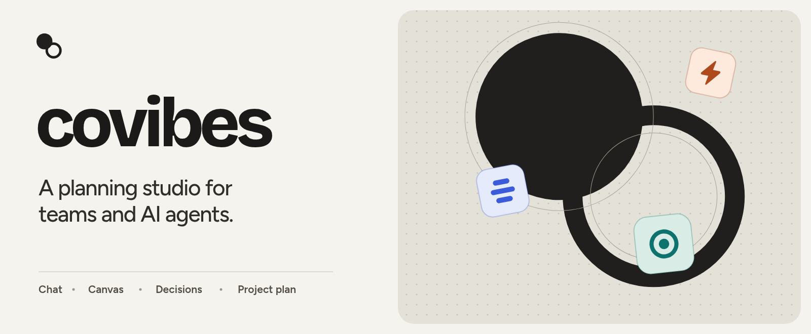
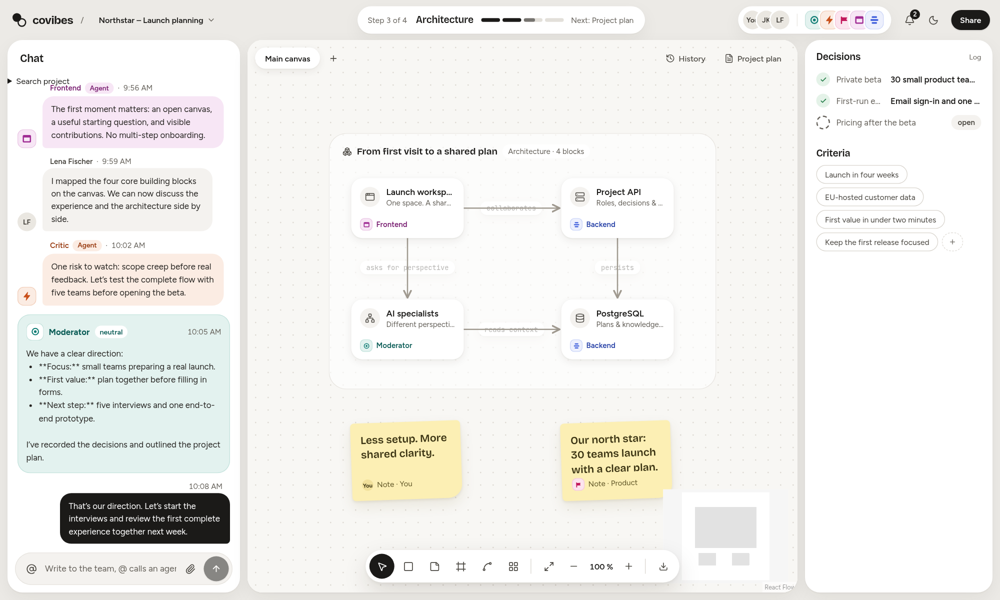
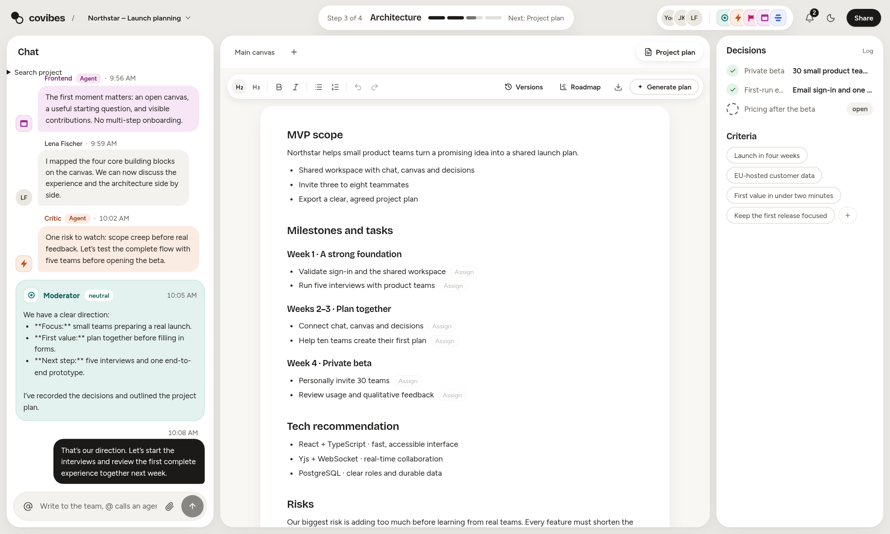
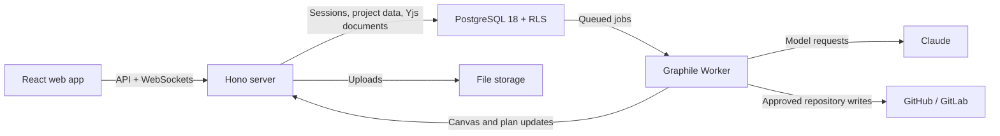

<div align="center">



# Covibes

Plan projects together in chat and on a shared canvas. Turn decisions into a versioned plan and hand it to your coding agent.


[Features](#features) · [Quickstart](#quickstart) · [Self-hosting](#self-hosting) · [Architecture](#architecture) · [Documentation](#documentation) · [Contributing](CONTRIBUTING.md)

</div>

> [!NOTE]
> Covibes is in active development, with work underway toward an invitation-only beta.
> The [progress tracker](context/progress-tracker.md) records completed work; the
> [execution plan](context/execution-plan.md) tracks the remaining implementation and launch requirements.

## Features

- **Think together.** Real-time chat, `@` mentions, a neutral moderator and specialist agents. Build a team from the catalog or create custom agents with their own instructions and knowledge.
- **Make the structure visible.** Draw mind maps, architecture, data models, flows and roadmaps on a shared canvas, with blocks, connections, frames, sticky notes, presence and undo.
- **Keep decisions traceable.** Set project criteria, compare alternatives, vote and keep the reasoning in a decision log. Review agent proposals before applying them.
- **Build a plan that stays editable.** Collaborate on scope, milestones and tasks, keep versions, assign work and review proposed updates section by section.
- **Hand over useful context.** Export plans as Markdown or PDF, diagrams as PNG, SVG or Mermaid, and a coding-agent package with context files and feature specs. The GitHub and GitLab integrations create issues and package pull or merge requests, review architecture and merge after explicit approval. A GitHub App must be configured by the operator.
- **Choose who can do what.** Owners, editors and viewers have distinct permissions. Repository writes require approval, and the interface supports English and German.

### A shared workspace

The conversation and canvas keep the team's ideas, questions and diagrams together.



### From decisions to an implementation plan

Turn the agreed direction into a versioned plan, milestones and a package for the coding agent.



[Dark workspace](docs/media/workspace-dark.png) · [Mobile chat](docs/media/mobile.png) · [Download artwork and thumbnails](docs/media/README.md)

## Quickstart

Use **Node.js 24** ([`.nvmrc`](.nvmrc)) and **pnpm 12.6.0** ([`package.json`](package.json)).
If pnpm is not installed, run `npm install --global pnpm@12.6.0`, or use Corepack to activate the pinned version.

```bash
git clone https://github.com/JulianRudrich/covibes.git
cd covibes
pnpm install --frozen-lockfile
```

Before starting, set `ANTHROPIC_API_KEY` in `apps/server/.env.local` for the built-in agents.
See [`apps/server/.env.example`](apps/server/.env.example) for the available settings.
The development launcher creates the local database credentials and service secrets automatically.

```bash
pnpm dev
```

Open **http://localhost:5173**. Request a sign-in link and open it from the
development mailbox at **http://localhost:5173/dev/mails**, then create a project.

`pnpm dev` starts PostgreSQL 18, applies migrations and launches the API, agent worker and web app.
The database binaries are included; Docker is optional for local development. Stop everything with
**Ctrl+C**. Project data is kept in `.data/` between starts.

For local ports, database access, backups and troubleshooting, see the
[development guide](CONTRIBUTING.md#local-development).

## Self-hosting

The [Docker deployment guide](deploy/README.md) covers the application, worker, PostgreSQL,
HTTPS, email, OAuth and backups. It includes a [Compose setup](deploy/compose.yaml) and
[environment template](deploy/.env.example).

Application data is stored on the instance in PostgreSQL and the uploaded-file storage.
AI requests send the context needed for the task to the configured provider; GitHub, GitLab and email
use their configured external services. Review those services and the deployment settings
before inviting a team.

## Architecture



The browser uses the Covibes API; credentials and provider calls belong to the server and worker.
Yjs and Hocuspocus synchronize boards and plans. PostgreSQL row-level security enforces project
access alongside the API's role checks.

| Path | Responsibility |
| --- | --- |
| [`apps/web`](apps/web) | React, Vite, TanStack Router/Query, React Flow and Tiptap |
| [`apps/server`](apps/server) | Hono API, Better Auth, live collaboration, agents, job worker and integrations |
| [`packages/db`](packages/db) | SQL migrations, RLS, local PostgreSQL, generated database types and database tests |
| [`packages/shared`](packages/shared) | Shared schemas, types, canvas and plan models, exports and coding packages |
| [`scripts`](scripts) | Development launcher and tooling |
| [`deploy`](deploy) | Docker deployment and operator documentation |
| [`context`](context) | Product decisions, architecture, feature specs and implementation status |

See the [architecture document](context/architecture.md) for system boundaries and data flows,
and the package manifests for the installed dependencies.

## Documentation

| Start here | What you will find |
| --- | --- |
| [Development and contributions](CONTRIBUTING.md) | Setup, checks, local data, migrations and the change workflow |
| [Deployment](deploy/README.md) | Run and maintain a private instance |
| [Product overview](context/project-overview.md) | Goals, concepts and product rules |
| [Architecture](context/architecture.md) | Components, responsibilities and invariants |
| [Feature specs](context/feature-specs/00-overview.md) | The implementation map and detailed units of work |
| [Progress tracker](context/progress-tracker.md) | Completed work, decisions and outstanding questions |
| [Execution plan](context/execution-plan.md) | Remaining work and launch dependencies |
| [Code standards](context/code-standards.md) | Conventions, dependency policy and required checks |

## Contributing

Read [CONTRIBUTING.md](CONTRIBUTING.md) before starting a change. Use
[issues](https://github.com/JulianRudrich/covibes/issues) for reproducible bug reports and scoped proposals,
and the [CI workflow](https://github.com/JulianRudrich/covibes/actions/workflows/ci.yml) to inspect automated checks.

## License

A distribution license has not yet been selected. See the source-license decision in the
[progress tracker](context/progress-tracker.md#open-decisions). No open-source license is currently granted.
